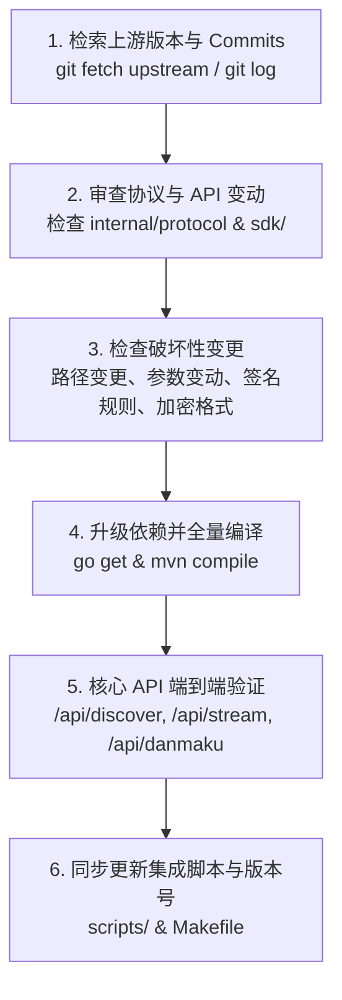

# Upstream SDK Upgrade & API Compatibility Checklist

本指南规范了在项目内升级上游 SDK（`github.com/beilunyang/openhongguo`）时的完整排查流程与校验规约。

> [!IMPORTANT]
> **核心规约**：每次更新或升级上游 SDK 后，**严禁仅完成 `go get` 和编译通过即结束**。必须执行 API 接口与底层协议变更审计，并针对核心流媒体与目录接口进行端到端冒烟验证。

---

## 一、 SDK 更新排查工作流

---

## 二、 关键检查项清单 (Checklist)

### 1. API 接口路径与协议版本变动
- [ ] **取址与播放协议变动**：
  - 检查播放模型路径是否发生变更（如历史上的 `/novel/player/video_model/v1/` 迁移至 `/novel/player/multi_video_model/player/v1` 等）。
  - 检查请求方法（GET / POST）及 Content-Encoding（是否要求 gzip 压缩请求体）。
  - 检查响应模型格式（如 dynamic_video_list / DASH 分片、bytevc1 / bytevc2 编码类型）。
- [ ] **目录与搜索路径变动**：
  - 检查推荐、短剧筛选、榜单、搜索、剧集详情接口路径是否有重构或重命名。
- [ ] **弹幕与评论协议变动**：
  - 检查弹幕拉取端点与查询参数变动。

### 2. 身份认证、设备注册与请求签名机制
- [ ] **签名头变更**：
  - 关注 `x-argus`, `x-ladon`, `x-medusa`, `x-helios`, `x-gorgon` 的生成逻辑。
  - 关注是否引入新的外部签名服务（如 `openhongguo-signer`）或新的请求头（如 `X-Signer-Token`）。
- [ ] **参数顺序与时间戳绑定**：
  - 部分接口（尤其是 V5 播放接口）对查询参数的绝对顺序（Query Pairs Order）及 `_rticket` 槽位有强校验，检查签名函数是否变动。
- [ ] **匿名设备与 Cookie 规则**：
  - 检查 `anonymousHeaders`、`guestCookie` 逻辑是否调整。
  - 确保本地设备配置自愈机制（如遇到无效匿名设备或 `anonymous response was empty` 时的自动重置）依然健全。

### 3. DRM 与流媒体解密流程
- [ ] **密钥推导算法**：
  - 确认 `sdk.ContentKey` 密钥还原逻辑是否有改动。
  - 确认 `cenc-aes-ctr` 解密是否受影响。
- [ ] **FFmpeg 转码参数适配**：
  - 检查 `server/internal/webserver/stream.go` 中传递给 FFmpeg 的解密参数（`-decryption_key`、输入流、音频流分离处理等）是否匹配最新返回格式。

---

## 三、 强制验证测试矩阵

完成 SDK 依赖升级后，必须在本地启动 `ohg-server` 或运行对应测试，逐一验证以下测试用例：

| 接口 / 功能 | 测试用例 | 预期结果 |
| :--- | :--- | :--- |
| **设备注册 / 状态** | `GET /api/system/status` | 返回 `status: ok`，匿名设备已就绪 |
| **推荐频道** | `GET /api/discover?channel=推荐` | 返回 HTTP 200，剧集列表非空且有效 |
| **漫剧 / 真人剧频道** | `GET /api/discover?channel=漫剧` | 返回 HTTP 200，正确加载分类列表 |
| **关键词搜索** | `GET /api/search?q=仙` | 返回 HTTP 200，搜索结果正常返回 |
| **剧集列表** | `GET /api/episodes?series_id={ID}` | 返回 HTTP 200，单集 ID 与标题正确 |
| **流媒体播放与解密** | `GET /api/stream?episode_id={ID}&series_id={ID}&quality=720p` | **返回 HTTP 206 Partial Content**，`video/mp4` 流可正常播放 |
| **弹幕接口** | `GET /api/danmaku?series_id={ID}&episode_id={ID}` | 返回 HTTP 200，弹幕数组正常 |

---

## 四、 升级后维护与构建同步

1. **版本声明同步更新**：
   - 更新 [scripts/integrate-upstream-sdk.ps1](file:///c:/Users/liuju/Documents/GitHub/openhongguo/scripts/integrate-upstream-sdk.ps1) 中的 `$Version` 参数。
   - 更新 [scripts/integrate-upstream-sdk.sh](file:///c:/Users/liuju/Documents/GitHub/openhongguo/scripts/integrate-upstream-sdk.sh) 中的 `VERSION` 默认值。
   - 更新 [Makefile](file:///c:/Users/liuju/Documents/GitHub/openhongguo/Makefile) 中的 `sdk-fetch` 依赖版本。
2. **全模块重新编译打包**：
   - 运行 `mvn compile` 或 `make build`。
   - 确保 [bin/](file:///c:/Users/liuju/Documents/GitHub/openhongguo/bin) 目录下的 `ohg.exe`、`ohg-server.exe` 和 `ohg-desktop.exe` 全部同步为最新编译版本。
3. **提交与推送**：
   - 遵循 Conventional Commits 规范（如 `fix(stream): ...` 或 `refactor(sdk): ...`），将改动与构建更新提交并推送到远端。
