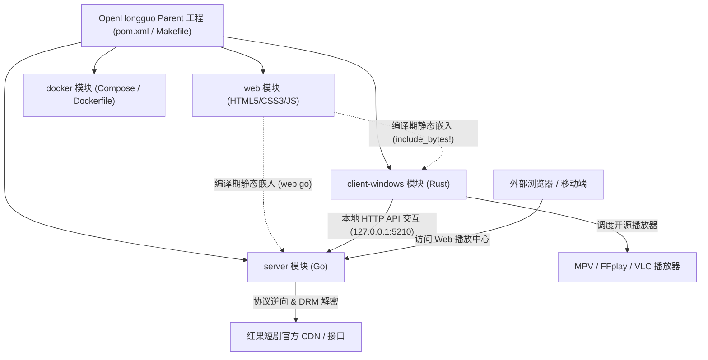

# OpenHongguo (红果短剧)

OpenHongguo 是一个遵循现代工程规范的开源短剧聚合与流媒体播放系统。本项目采用类似 **Maven 多模块工程架构** 进行全量分层重构，将整个项目划分为服务端 (`server`)、Windows 客户端 (`client-windows`) 与 Web 前端 (`web`) 三大独立高内聚子模块，并提供统一的构建管理与快速启动入口。

---

## 🏛️ 多模块架构设计 (Maven-like Architecture)

本项目采用规范的树状父子工程组织方式，根目录作为父工程进行统一依赖聚合与多模块反应堆编排，各个业务子模块职责清晰、边界明确：

```
openhongguo/                               # [Parent] 根工程聚合器
├── pom.xml                                # Maven 父工程定义 (Parent POM)
├── Makefile                               # 统一构建编排 Makefile
│
├── bin/                                   # 统一编译产物输出目录
│   ├── ohg-server.exe                     # 服务端与静态资源托管可执行文件
│   ├── ohg-desktop.exe                    # Windows 原生无边框桌面客户端
│   └── ohg.exe                            # 终端交互式命令行工具 (CLI)
│
├── server/                                # [Module 1] 服务端核心模块 (Go)
│   ├── pom.xml                            # Maven 服务端子模块定义
│   ├── README.md                          # 服务端独立文档
│   ├── cmd/                               # 服务端应用主入口 (ohg-server, ohg)
│   ├── internal/                          # 核心业务逻辑 (webserver, protocol, drm, favorite, history)
│   ├── adapters/                          # 基础存储与传输适配器 (filestore, httptransport, memstore)
│   ├── sdk/                               # Go 原生业务 SDK
│   └── bindings/                          # 多端语言绑定 (Mobile, Flutter, Node, React Native)
│
├── client-windows/                        # [Module 2] Windows 原生客户端模块 (Rust)
│   ├── pom.xml                            # Maven Windows 客户端子模块定义
│   ├── README.md                          # Windows 客户端独立文档
│   ├── Cargo.toml                         # Rust 包与依赖清单
│   └── src/                               # 原生无边框窗口、播放器探测 (MPV/VLC/FFplay) 与 UI 服务
│
├── web/                                   # [Module 3] Web 前端客户端模块 (HTML5/CSS3/ES6)
│   ├── pom.xml                            # Maven Web 端子模块定义
│   ├── package.json                       # Web 端工程元数据
│   ├── README.md                          # Web 端独立文档
│   ├── index.html                         # 单页面应用 (SPA) 模板
│   ├── web.go                             # Go embed 静态资源一键打包桥接器
│   ├── css/                               # 模块化样式 (布局、栅格、影院模式、响应式)
│   └── js/                                # 模块化脚本 (状态总线、API、选集分页、ArtPlayer 播放器)
│
├── docker/                                # [Module 4] 容器化构建与编排模块
│   ├── pom.xml                            # Maven Docker 子模块定义
│   ├── Dockerfile                         # 镜像多阶段极速构建文件
│   ├── docker-compose.yml                 # 容器编排服务配置
│   ├── .dockerignore                      # 构建上下文过滤规则
│   ├── README.md                          # Docker 部署与运维指南
│   ├── start-docker.bat                   # Windows 容器一键构建启动脚本
│   └── start-docker.sh                    # Linux/macOS 容器启动脚本
│
└── scripts/                               # 统一运维、打包与启动脚本目录
    ├── windows/                           # Windows 批处理启动脚本与快捷方式生成器
    └── docker/                            # Docker 一键构建与容器启动脚本
```

### 架构拓扑与交互关系



---

## 🚀 快速启动

根目录下提供了针对不同使用场景的开箱即用批处理脚本：

| 启动脚本 | 说明 | 适用场景 |
| :--- | :--- | :--- |
| `start-desktop.bat` | 一键启动 Windows 原生无边框独立客户端 | 桌面端用户日常观影，支持独立窗口与系统播放器联动 |
| `start-server.bat` | 仅启动后台 API 服务 (监听 5210 端口) | 作为本地/局域网服务运行，供其他设备远程连接调用 |
| `start-web.bat` | 启动后台服务并在默认浏览器中自动打开界面 | 习惯使用 Chrome/Edge 浏览器全屏观看的用户 |
| `start-docker.bat` | 基于 Docker BuildKit 极速构建并启动容器 | Linux/NAS/私有云服务器无人值守部署 |
| `create-desktop-shortcut.ps1` | 在 Windows 桌面上生成「红果短剧」快捷方式 | 一键创建桌面快捷图标 |

---

## 🛠️ 构建与编译方式

### 1. Maven 多模块构建 (推荐)
本项目完整支持 Maven 反应堆编排，由 `openhongguo-parent` 统一调度：
```bash
# 一键编译所有子模块 (server, client-windows, web)
mvn compile

# 仅编译服务端模块
mvn compile -pl server

# 仅编译 Windows 桌面客户端模块
mvn compile -pl client-windows

# 清理构建产物
mvn clean
```

### 2. Make 构建
```bash
make binaries   # 构建全部二进制 (CLI, Server, Windows Client)
make server     # 仅构建 Go 服务端 bin/ohg-server.exe
make windows    # 仅构建 Rust 客户端 bin/ohg-desktop.exe
make test       # 运行自动化单元测试
```

### 3. Docker 容器构建
```bash
# 使用 Docker Compose 一键拉起
docker compose up -d --build
```

---

## 📦 模块分工说明

- **[server (openhongguo-server)](server/README.md)**：包含服务端主程序、命令行工具与核心 SDK。负责请求签名、短剧元数据爬取、DRM 内容解密流转发、用户匿名身份激活与追剧进度持久化。
- **[client-windows (openhongguo-client-windows)](client-windows/README.md)**：专为 Windows 平台打造的高性能原生客户端，以极小的系统开销拉起无边框独立窗口，内置开源播放器嗅探引擎，支持一键调用 MPV/FFplay 进行硬件加速播放。
- **[web (openhongguo-web)](web/README.md)**：模块化设计的轻量级短剧前端播放中心，内置 ArtPlayer 播放器内核，支持 9:16 移动端竖屏与 16:9 横屏双向适配、沉浸式影院模式以及 30 集分段大号选集面板。
- **[docker (openhongguo-docker)](docker/README.md)**：容器化极速构建与服务编排模块，集成 BuildKit 缓存加速、国内镜像源预设、健康检查探活与数据卷持久化。

---

## 免责声明（Disclaimer）

### 1. 项目性质与研究目的
- 本项目（以下简称“本项目”）系开源技术交流与个人学习研究所用，旨在探讨移动端应用网络通信协议分析、流媒体技术规范及跨平台客户端工程架构。
- 本项目仅供技术人员交流与学习参考，开发者不对本项目的商业实用性、完整性、可靠性或接口持续有效性作任何形式的明示或暗示保证。

### 2. 知识产权与版权声明
- 本项目所涉及的短剧、视频、音频、剧本、封面图片、文字介绍以及平台商标等全部数字媒体资产，其知识产权与所有合法权益均严格归属于原版权权利人或原发布平台。
- 本项目代码仓库及编译产物**不包含、不托管、亦不分发**任何实际的音频或视频文件内容。所有流媒体地址解析逻辑均由学习目的之协议调用产生，用户通过本项目获取的内容仅供临时学习、技术研究之用，应于研究完成后 24 小时内自行删除。

### 3. 合规使用与禁止商业化
- 严禁将本项目及其衍生代码、工具用于任何形式的商业用途、营利活动或商业分发。
- 严禁利用本项目对第三方平台实施大规模数据抓取、暴力请求、恶意刷量、服务拒绝攻击或任何破坏平台正常技术架构及网络安全的行为。
- 严禁利用本项目侵犯任何个人、企业或组织的知识产权、商业秘密或合法权益。

### 4. 责任免除与风险自担
- 使用者在下载、编译、安装、运行或修改本项目的过程中，须严格遵守使用者所在司法管辖区及中华人民共和国相关法律法规（包括但不限于《中华人民共和国网络安全法》、《中华人民共和国数据安全法》、《中华人民共和国著作权法》等）。
- 因使用、修改、分发本项目代码或因滥用接口引发的任何法律争议、行政处罚、民事赔偿责任、刑事责任或直接/间接损失，均由**使用者本人独立承担全部法律后果**，本项目作者及全部贡献者不承担任何直接、间接或连带责任。

### 5. 接受条款
- 任何个人或组织一旦克隆（Clone）、下载、复刻（Fork）、引用、编译或以任何方式使用本项目，即视为已仔细阅读、充分理解并完全同意本声明的全部条款与条件。如不同意本声明的任何条款，请立即停止使用并删除所有相关代码与衍生文件。

---

## 许可证（License）

本项目源代码遵循 [Apache License 2.0](LICENSE) 开源许可证。
